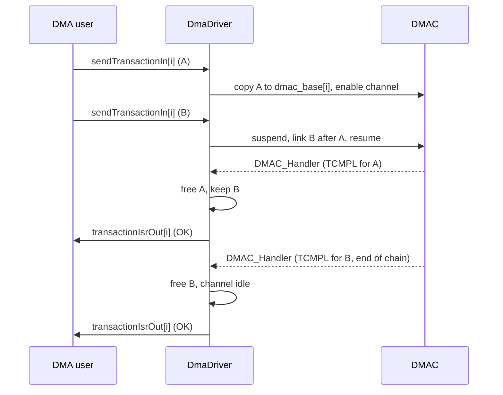
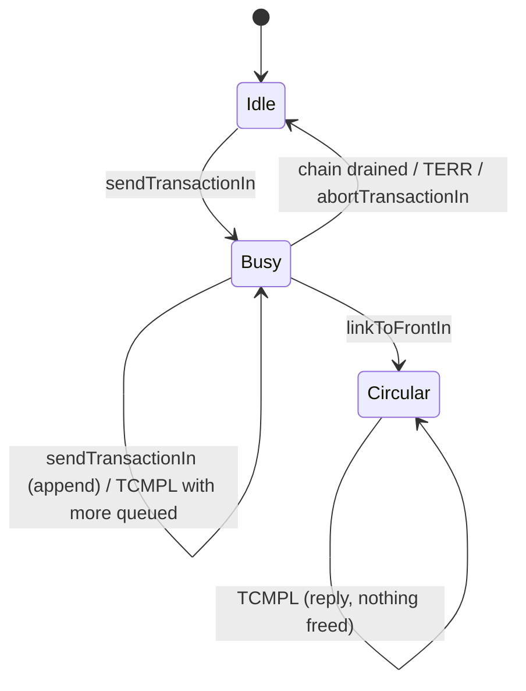

# Samd21::DmaDriver

Queues DMA transfers on the SAMD21 DMAC and reports each completed transfer from the DMAC
interrupt.

## 1. Introduction

`DmaDriver` owns the SAMD21 Direct Memory Access Controller. Peripheral drivers (`UsartDriver`,
`SpiDriver`, `I2cDriver`) hand it transfers on one of the 12 hardware channels. The port index
is the channel number. Transfers queued on a busy channel are linked behind the active one and
run back to back without CPU involvement. Each completed transfer is reported back on the same
channel index from the DMAC interrupt. A channel can also be turned into a circular chain (used
for USART RX), have its in-flight progress read, or be aborted.

## 2. Requirements

| Name           | Description                                                                                                                                                          | Validation    |
| -------------- | -------------------------------------------------------------------------------------------------------------------------------------------------------------------- | ------------- |
| SAMD21-DMA-001 | DmaDriver shall run transfers on each of the 12 DMAC channels independently, with the port index selecting the channel.                                              | Hardware Test |
| SAMD21-DMA-002 | DmaDriver shall execute each requested transfer with the requested trigger source, trigger action, priority, beat size, beat count, address increments and step size. | Hardware Test |
| SAMD21-DMA-003 | DmaDriver shall start a transfer requested on an idle channel immediately, and shall run a transfer requested on a busy channel after the transfers already queued there, in request order. | Hardware Test |
| SAMD21-DMA-004 | DmaDriver shall report each completed transfer exactly once, as OK, on the reply port of the channel it ran on, in completion order.                                 | Hardware Test |
| SAMD21-DMA-005 | DmaDriver shall report a bus error on a channel as a single BUS_ERROR reply carrying the bytes not transferred, and shall drop every transfer still queued on that channel. | Hardware Test |
| SAMD21-DMA-006 | On request, DmaDriver shall link a channel's last queued transfer back to its first, so the chain repeats until the channel is reset, reporting each completed transfer as OK. | Hardware Test |
| SAMD21-DMA-007 | On request, DmaDriver shall return a snapshot of a busy channel's in-flight transfer state without stopping or altering the transfer.                               | Hardware Test |
| SAMD21-DMA-008 | On request, DmaDriver shall stop a channel's active transfer, drop its queued transfers and report nothing for them. A request on an idle channel shall have no effect. | Hardware Test |
| SAMD21-DMA-009 | DmaDriver shall hold at most `DMA_DESCRIPTOR_N` (16) queued transfers across all channels, in statically allocated memory.                                          | Inspection    |
| SAMD21-DMA-010 | DmaDriver shall deliver completion replies from the DMAC interrupt at the lowest NVIC priority, and a reply handler may queue a new transfer from inside the reply.   | Hardware Test |

DmaDriver has no unit tests. Almost all of its logic reads or writes DMAC registers and the
DMAC-owned descriptor memory, and splitting that behind a HAL for host testing was judged not
worth the cost. All requirements are verified on hardware through the drivers that use DMA
(see Tested Configurations).

## 3. Design

### Descriptors

The DMAC runs a channel from its base descriptor in `dmac_base[channel]` and writes progress to
`dmac_writeback[channel]`. Both arrays are 16-byte aligned and placed in `SECTION_DMAC_DESCRIPTOR`.
Further transfers on a busy channel are linked through `DESCADDR` into a pool of
`DMA_DESCRIPTOR_N` descriptors shared by all channels (`DmaDriverConfig.hpp`). A `U32` bitfield
tracks the pool, so `DMA_DESCRIPTOR_N` is limited to 32 (`static_assert`).

A transfer requested on an idle channel is built in a pool descriptor, copied into the base
descriptor, and the pool descriptor is freed straight away. The channel is then reset,
configured (priority, trigger source, trigger action) and enabled. A transfer requested on a
busy channel takes a pool descriptor, which stays allocated until that transfer completes.

The descriptor end addresses follow datasheet 21.10.3 / 21.10.4:
`ADDR = START + BTCNT * bytesPerBeat * 2^STEPSIZE` on the side `stepSelection` names, and
`ADDR = START + BTCNT * bytesPerBeat` otherwise.

### Appending to a busy channel

`sendTransactionIn` suspends the channel, links the new descriptor onto the tail of the chain,
and resumes it. The DMAC caches the next-descriptor pointer in the write-back when it starts a
block (21.6.2.5). If the write-back shows the tail is executing (`DESCADDR == 0`), the link is
written there as well, so the hardware fetches the new descriptor instead of ending the chain.

The channel can still finish and auto-disable before the link lands. The interrupt handler
covers that case. If the node it keeps after freeing completed nodes has not run and the
channel reads disabled, it reloads that node as the base descriptor and re-enables the channel
(`DmaChannel::restart`), the same way a fresh transfer starts.

### Interrupt handling

`DMAC_Handler` (`DmaDriverIsr.cpp`, built without LTO so it is not discarded) calls
`handleInterrupt()` through the singleton `s_instance`. The handler runs inside a
`Samd21::CriticalSection`, handles one channel per entry (`INTPEND.ID`), and services flags in
this order:

1. **TERR (bus error).** FERR set means an invalid descriptor, which is a programming error and
   asserts. Otherwise it frees the whole queued chain (unless circular), marks the channel idle
   and records `BTCNT << BEATSIZE` as the bytes not transferred.
2. **TCMPL (transfer complete).** One interrupt can cover several completed blocks. The handler
   finds the node the DMAC is on now from the write-back (`VALID` and `DESCADDR`). It frees
   every node before that one and queues one OK reply for each freed node. A circular channel
   frees nothing and queues one reply.
3. **SUSP.** With FERR and `DESCADDR == 0` it is the normal end of the chain, and the channel
   is marked idle. With FERR and a non-zero `DESCADDR` it asserts.

Replies are sent only after every flag is cleared and the bookkeeping is settled. A reply
handler can therefore queue the next transfer on the same channel from inside the reply.

A typical TX sequence, with a second transfer queued while the first is running:



Each channel moves between three states:



### Writeback snapshot and abort

`readWritebackIn` suspends the channel, waits for `CHINTFLAG.SUSP`, copies the write-back and
resumes. The transfer continues into the same buffer. `UsartDriver` uses this to drain a
partly filled RX buffer.

`abortTransactionIn` disables the channel's interrupts, then the channel itself. The current
beat finishes and the write-back is updated (20.6.3.6). It then clears the write-back so the
next enable fetches the new base descriptor, clears any latched flags, frees the chain and
marks the channel idle. Disabling raises no interrupt, so no reply is sent. The owner of the
channel reports the aborted transfer itself.

### Concurrency

All ports are `sync`. On this baremetal target the only concurrency is the DMAC interrupt, so
every handler that touches channel state or the descriptor pool runs inside a
`Samd21::CriticalSection`. The only work done outside one is building the pool descriptor,
which the interrupt never reads. Every hardware wait (DMAC reset, channel disable, channel
suspend) is bounded by `F_CPU` iterations and asserts on timeout.

## 4. Ports

| Kind         | Name                 | Port Type              | Usage                                                     |
| ------------ | -------------------- | ---------------------- | --------------------------------------------------------- |
| `sync input` | `sendTransactionIn`  | `Dma.Transaction`      | Queue a transfer on channel `[i]`                         |
| `sync input` | `linkToFrontIn`      | `Fw.Signal`            | Make channel `[i]`'s queued chain circular                |
| `sync input` | `abortTransactionIn` | `Fw.Signal`            | Abort channel `[i]` and drop its queue (no reply)         |
| `sync input` | `readWritebackIn`    | `Dma.ReadWriteback`    | Return channel `[i]`'s in-flight write-back               |
| `output`     | `transactionIsrOut`  | `Dma.TransactionReply` | Completion reply for channel `[i]`, sent from the DMAC ISR |

Each port is an array of `Dma.CHANNEL_NUM` (12). Index `i` is DMAC channel `i`.

The component has no commands, events, telemetry or parameters.

## 5. Integration

Assign each DMA user a channel and wire the request and reply ports on the same index:

```fpp
enum DmaChannel : U8 {
    SERCOM4_USART_GSE_TX
    SERCOM4_USART_GSE_RX
    SERCOM5_I2C_WRITE
    SERCOM5_I2C_READ
}

instance dmaDriver: Samd21.DmaDriver base id 0x3000

connections Dma {
    uart.dmaQueueOut[Samd21.UsartDriver.DmaChannel.TX] -> dmaDriver.sendTransactionIn[DmaChannel.SERCOM4_USART_GSE_TX]
    dmaDriver.transactionIsrOut[DmaChannel.SERCOM4_USART_GSE_TX] -> uart.dmaReplyIn[Samd21.UsartDriver.DmaChannel.TX]

    uart.dmaQueueOut[Samd21.UsartDriver.DmaChannel.RX] -> dmaDriver.sendTransactionIn[DmaChannel.SERCOM4_USART_GSE_RX]
    dmaDriver.transactionIsrOut[DmaChannel.SERCOM4_USART_GSE_RX] -> uart.dmaReplyIn[Samd21.UsartDriver.DmaChannel.RX]
    uart.dmaRxCircular -> dmaDriver.linkToFrontIn[DmaChannel.SERCOM4_USART_GSE_RX]
    uart.dmaRxRead -> dmaDriver.readWritebackIn[DmaChannel.SERCOM4_USART_GSE_RX]

    i2cDriver.dmaTransactionAbortOut[Samd21.I2cDriver.DmaChannel.WRITE] -> dmaDriver.abortTransactionIn[DmaChannel.SERCOM5_I2C_WRITE]
}
```

Call `dmaDriver.configure()` in the `configComponents` phase, before any DMA user is
configured. It enables the DMAC clocks, resets the controller, sets the descriptor and
write-back base addresses, enables all four priority levels, keeps the DMAC running in debug
halt, and enables `DMAC_IRQn` at the lowest NVIC priority.

### Tested Configurations

| Board                    | Chip       | Use                                                                  |
| ------------------------ | ---------- | -------------------------------------------------------------------- |
| Microchip Curiosity Nano | SAMD21G17A | SERCOM0 / SERCOM3 USART TX and circular RX                           |
| FFB                      | SAMD21J17D | SERCOM4 / SERCOM2 USART TX and circular RX, SERCOM5 I2C, SERCOM0 SPI |

## 6. Limitations

- **One instance.** `DMAC_Handler` reaches the driver through `s_instance`, and the constructor
  asserts if one already exists.
- **Asserts on misuse.** These all assert rather than return an error: an exhausted descriptor
  pool, a zero source or destination address, an address not aligned to the beat size, an
  invalid enum, an append, abort or second `linkToFront` on a circular channel, `linkToFront`
  with only one queued transfer, and `readWritebackIn` on an idle channel. Size
  `DMA_DESCRIPTOR_N` for the largest number of transfers that can be queued at once across all
  channels (FFB uses 16).
- **Zero-length transfers are not rejected.** The DMAC does not define `BTCNT == 0`, so callers
  must not request one. `SpiDriver` and `I2cDriver` assert a non-zero size before queuing.
- **Circular is permanent.** A circular channel cannot accept more transfers, be aborted, or go
  back to one-shot mode. Its descriptors are never freed.
- **Bus errors are not retried.** The hardware disables the channel on TERR. Every transfer
  still queued on that channel is dropped without its own reply. The single BUS_ERROR reply
  stands for all of them.
- **No software trigger.** A transfer with `TriggerSource::DISABLE` waits for a software or
  event trigger that this driver never issues.
- **Interrupt latency.** The reply handlers run inside the DMAC ISR with interrupts disabled.
  They must return promptly and must not block.

### Memory

| Item                                   | Size      |
| -------------------------------------- | --------- |
| Component object (FFB, `dmaDriver`)    | 368 bytes |
| `dmac_base` + `dmac_writeback` (2 × 12 × 16 bytes) | 384 bytes |
