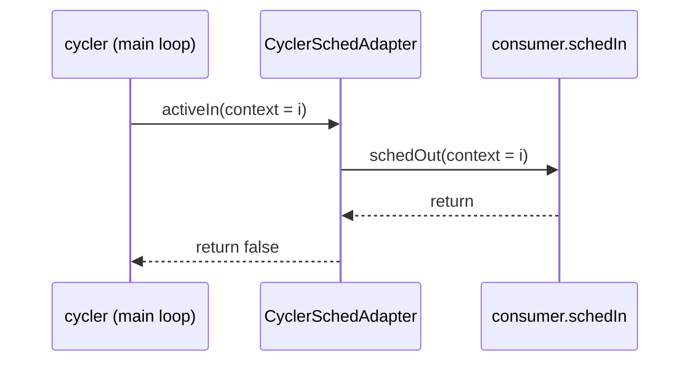

# Samd21::CyclerSchedAdapter

## Introduction

`Samd21.CyclerSchedAdapter` is a passive helper that lets an ordinary `Svc.Sched` consumer be driven from the baremetal main-loop cycler. The cycler calls the adapter's `Svc.ActiveSched` input; the adapter forwards that call to its single `Svc.Sched` output with the same context and reports that no further work is pending. A consumer such as a peripheral driver therefore needs only a plain `schedIn` port and is not aware of the cycler protocol; one adapter instance is placed in front of each such consumer.

## Requirements

| ID | Requirement | Verification |
|---|---|---|
| REQ-CSA-001 | On each `activeIn` call, the adapter shall invoke `schedOut` exactly once. | Unit test |
| REQ-CSA-002 | The adapter shall pass the `activeIn` context argument to `schedOut` unchanged. | Unit test |
| REQ-CSA-003 | `activeIn` shall block on the `schedOut` invocation until it returns. | Unit test |
| REQ-CSA-004 | The adapter shall return `false` from every `activeIn` call with `schedOut` connected. | Unit test |
| REQ-CSA-005 | With `schedOut` unconnected, an `activeIn` call shall assert. | Unit test |
| REQ-CSA-006 | The adapter shall not allocate dynamic memory. | Inspection |
| REQ-CSA-007 | The adapter shall define no commands, events, telemetry channels, or parameters. | Inspection |
| REQ-CSA-008 | The adapter's `schedOut` invocations shall not depend on prior `activeIn` calls on any instance. | Unit test |
| REQ-CSA-009 | The adapter shall invoke `schedOut` only during an `activeIn` call. | Unit test |

## Design

### Block diagram

```text
                          +-------------------------------+
 Svc.ActiveSched          |                               |
 ─────────────────────▶ ■ | activeIn : Svc.ActiveSched    |
 (sync, returns false)    |                               |
                          |  Samd21.CyclerSchedAdapter    | schedOut : Svc.Sched ■ ─────▶ Svc.Sched
                          |                               |   (context unchanged)
                          +-------------------------------+
```

### Ports

| Port | Kind | Type | Purpose |
|---|---|---|---|
| `activeIn` | sync input | `Svc.ActiveSched` (returns `bool`) | Turn from the main-loop cycler |
| `schedOut` | output | `Svc.Sched` | Forwarded turn; context = `activeIn` context (cycler slot index), opaque to the consumer |

### Commands / Events / Telemetry / Parameters

| Kind | Count |
|---|---|
| Commands, events, telemetry channels, parameters | none (REQ-CSA-007) |

### Configure

Nothing to configure: no constants, no `configure()` call, no init arguments. One instance per
`Svc.Sched` consumer; no dictionary items, so the instance may share the deployment's
no-dictionary base id:

```fpp
instance framSched: Samd21.CyclerSchedAdapter base id FixedBaseIds.NO_DICTIONARY
```

Wiring (`cycler.cycleOut -> framSched.activeIn`, `framSched.schedOut -> <consumer>.schedIn`) is
specified in the topology change. Cost per instance: one passive component object (no members
beyond the base class; RAM measured at implementation) and one `cycler.cycleOut` slot —
`PassiveRateGroupOutputPorts` bounds adapters and direct `activeIn` consumers together.

### Behavior

`Svc.PassiveCycler.cycle()` loops over its connected `cycleOut` ports until none reports work.
When it reaches the adapter's slot `i` it calls `activeIn(i)`; the adapter calls `schedOut(i)`,
blocks while the consumer runs to completion on the same stack, then returns `false`, so the cycler never re-polls on the adapter's account. The adapter cannot report
pending work: `cycle()` is followed by `wfi` in the deployment main loop, so a consumer's next
`schedIn` turn comes at the next *interrupt*, not immediately. **Constraint on consumers wired
through this adapter:** complete all CPU-ready work within one `schedIn` call; defer only work that
an interrupt (DMA/SERCOM/RTC) will wake. A consumer that needs the re-poll keeps its own
`Svc.ActiveSched` port instead. With `schedOut` unconnected the call asserts: the autocoded
`schedOut_out` checks the connection and `FW_ASSERT`s if absent, so the handler adds no check of its
own (REQ-CSA-005). An instance exists only to pass through to a consumer; an unconnected output is a
topology error caught on the first `cycle()` after boot.
Interaction constraints: `activeIn` is called only from the deployment main loop
(`Svc.PassiveCycler.cycle()`), never from interrupt context; the consumer's `schedIn` executes on
that stack within the `activeIn` call (REQ-CSA-003/009). The adapter holds no state, so no
execution-context guard is needed.



## Tests

| Test | Description | Requirements |
|---|---|---|
| UT-001 ForwardOnce | One `activeIn` call forwards exactly one `schedOut` call and returns false. | REQ-CSA-001, REQ-CSA-004 |
| UT-002 ContextPassThrough | Contexts 0, 1, 7, 0xFFFFFFFF arrive at `schedOut` unchanged. | REQ-CSA-002 |
| UT-003 NestedCompletion | `schedOut` handler has returned when `activeIn` returns (flag order); no call outside `activeIn`. | REQ-CSA-003, REQ-CSA-009 |
| UT-004 Unconnected | `schedOut` unconnected: `activeIn(3)` dies by FW_ASSERT (`ASSERT_DEATH_IF_SUPPORTED`); connected control instance forwards once. | REQ-CSA-005 |
| UT-005 HistoryIndependence | 100 interleaved calls on two instances: each forwards once, own context, returns false. | REQ-CSA-008, REQ-CSA-001, REQ-CSA-004 |
| UT-006 NoIdleOutput | After construct/init/connect and before any `activeIn`, `from_schedOut` history is 0. | REQ-CSA-009 |
| INSP-006 NoHeap | `nm -u` of the cross library lists no malloc/sbrk/operator-new family symbol. | REQ-CSA-006 |
| INSP-007 NoDictionary | FPP has only port specifiers; generated base has no cmd/event/tlm/prm members. | REQ-CSA-007 |
| SYS-none | No system test: no observables, no consumer in CuriosityReference; delegated to the consumer run. | REQ-CSA-001 … REQ-CSA-009 (waived at system level) |
