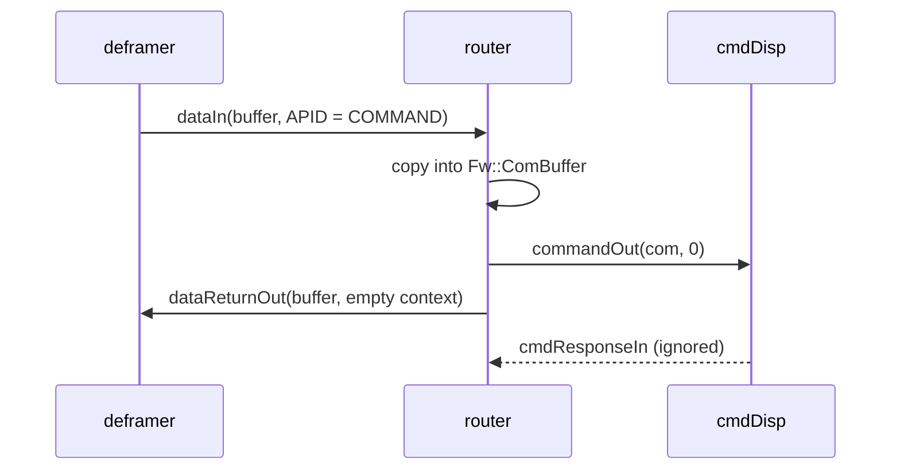

# Samd21::FprimeRouter

Routes packets deframed by the Deframer to the rest of the system.

## 1. Introduction

`FprimeRouter` receives deframed packets on `dataIn` and routes them by the APID in their frame
context: commands to `commandOut`, file packets to `fileOut`, and everything else to
`unknownDataOut`. It is a smaller copy of `Svc.FprimeRouter` that drops the buffer-context table.
The upstream router stores the frame context of every handed-off buffer so it can restore that
context on return. This variant returns handed-off buffers with an empty context, which saves the
table's RAM and its events. The deframers in this project (`Svc.FprimeDeframer` feeding
`Svc.FrameAccumulator`) ignore the returned context.

## 2. Requirements

| Name              | Description                                                                                                                                                       | Validation |
| ----------------- | ----------------------------------------------------------------------------------------------------------------------------------------------------------------- | ---------- |
| SAMD21-ROUTER-001 | FprimeRouter shall copy each command packet (APID `FW_PACKET_COMMAND`) of up to `FW_COM_BUFFER_MAX_SIZE` bytes, unchanged, to `commandOut` with context 0.        | Unit Test  |
| SAMD21-ROUTER-002 | FprimeRouter shall drop a command packet larger than `FW_COM_BUFFER_MAX_SIZE` bytes and report it with a warning event, at most 5 times per 60 s.            | Unit Test  |
| SAMD21-ROUTER-003 | FprimeRouter shall hand each file packet (APID `FW_PACKET_FILE`) to `fileOut`, and each packet with any other APID to `unknownDataOut` with its frame context.     | Unit Test  |
| SAMD21-ROUTER-004 | FprimeRouter shall return every buffer received on `dataIn` exactly once on `dataReturnOut`: a command buffer before `dataIn` returns, and a handed-off buffer when it comes back on `fileBufferReturnIn`. | Unit Test  |
| SAMD21-ROUTER-005 | When `fileOut` or `unknownDataOut` is not connected, FprimeRouter shall return a packet routed to it on `dataReturnOut` immediately, with the context it arrived with. | Unit Test  |
| SAMD21-ROUTER-006 | FprimeRouter shall accept command responses on `cmdResponseIn` and take no action on them.                                                                        | Unit Test  |

## 3. Design

| APID                | Routed to        | Returned on `dataReturnOut`                       | Context returned |
| ------------------- | ---------------- | ------------------------------------------------- | ---------------- |
| `FW_PACKET_COMMAND` | `commandOut`     | Immediately, after the copy into an `Fw::ComBuffer` | Empty (default)  |
| `FW_PACKET_FILE`    | `fileOut`        | When the receiver calls `fileBufferReturnIn`      | Empty (default)  |
| Any other           | `unknownDataOut` | When the receiver calls `fileBufferReturnIn`      | Empty (default)  |
| File / other, port unconnected | — | Immediately                                   | As received      |

The command copy is an `Fw::ComBuffer` on the stack (`FW_COM_BUFFER_MAX_SIZE` plus its header). It
is the router's only memory use, and the incoming buffer is free again as soon as `commandOut`
returns. The component holds no routing state; its only state is the autocoded event throttle.

`dataIn` and `fileBufferReturnIn` are `guarded` (from `Svc.Router`). On SAMD21 `Os::Mutex` is
`Os::Samd21::Mutex`, a flag that asserts on re-entry rather than blocking. All uplink traffic
reaches the router from main context through the UART driver's `activeIn`, so the guard is never
contended.

A command uplink:



## 4. Ports

| Kind           | Name                 | Port Type                 | Usage                                                         |
| -------------- | -------------------- | ------------------------- | ------------------------------------------------------------- |
| `guarded input`| `dataIn`             | `Svc.ComDataWithContext`  | Deframed packet and its frame context                         |
| `output`       | `dataReturnOut`      | `Svc.ComDataWithContext`  | Returns ownership of every `dataIn` buffer to the deframer    |
| `output`       | `commandOut`         | `Fw.Com`                  | Command packets; must be connected                            |
| `sync input`   | `cmdResponseIn`      | `Fw.CmdResponse`          | Command status from the dispatcher; ignored                   |
| `output`       | `fileOut`            | `Fw.BufferSend`           | File packets; ownership passes to the receiver (optional)     |
| `output`       | `unknownDataOut`     | `Svc.ComDataWithContext`  | Packets with any other APID; ownership passes to the receiver (optional) |
| `guarded input`| `fileBufferReturnIn` | `Fw.BufferSend`           | Returns buffers handed off on `fileOut` or `unknownDataOut`   |

The component also has the standard time, event and text event ports.

## 5. Events

| Event                  | Severity       | Description                                                  |
| ---------------------- | -------------- | ------------------------------------------------------------ |
| `SerializationError`   | `warning high` | A command packet did not fit an `Fw::ComBuffer` and was dropped. Throttled to 5 per 60 s, so a stream of oversize uplink cannot flood the event log |

The component has no commands, telemetry, or parameters.

## 6. Configuration

None. Unlike `Svc.FprimeRouter`, it does not use `FprimeRouterCfg::BufferContextTableSize`.

## 7. Integration

From the FFB link subtopology (`FFB/FFB/link.fpp`):

```fpp
instance router: Samd21.FprimeRouter base id BASE_ID + 0x30

connections Uplink {
    deframer.dataOut     -> router.dataIn
    router.dataReturnOut -> deframer.dataReturnIn

    router.commandOut    -> cmdDisp.seqCmdBuff
    cmdDisp.seqCmdStatus -> router.cmdResponseIn
}
```

- `commandOut` and `dataReturnOut` must be connected. The router calls them without checking.
- A receiver connected to `fileOut` or `unknownDataOut` must give every buffer back on
  `fileBufferReturnIn`, or the deframer never gets it back.
- Whatever is connected to `dataReturnOut` must not depend on the returned context of a handed-off
  buffer. Use `Svc.FprimeRouter` if it does.

## 8. Limitations

- The frame context (APID, VC ID, sequence count) of a handed-off buffer is lost on return.
- Command packets larger than `FW_COM_BUFFER_MAX_SIZE` (128 bytes on FFB) are dropped. Past the
  throttle limit they are dropped without an event.
- `fileBufferReturnIn` does not check that a buffer was handed off. Any buffer passed to it goes
  out on `dataReturnOut`.
- `cmdResponseIn` ignores command responses, so a failed command is not reported back to the link.

## 9. Tested Configurations

| Board                    | Chip       | Link                                      |
| ------------------------ | ---------- | ----------------------------------------- |
| Microchip Curiosity Nano | SAMD21G17A | Breadboard GDS uplink over SERCOM0 USART  |
| FFB                      | SAMD21J17D | GSE (SERCOM4) and FC (SERCOM2) USART uplink |
