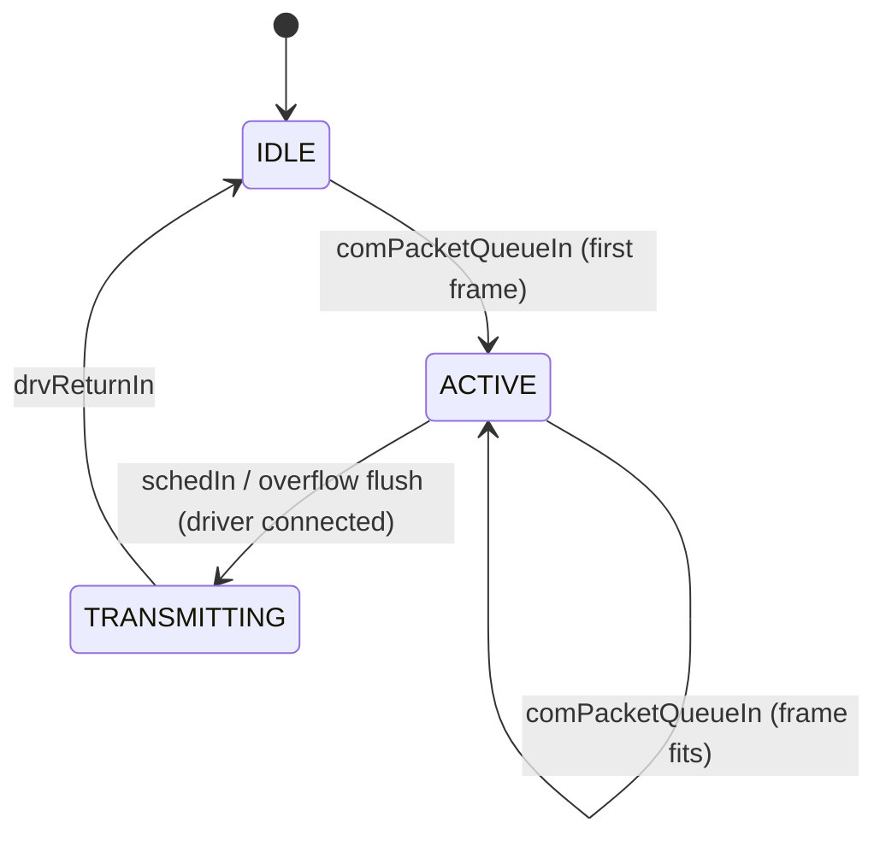

# Samd21::Framer

Frames downlink packets with the F Prime protocol and sends them to the driver in batches from two static buffers.

## 1. Introduction

`Framer` is the passive, statically allocated downlink framer for SAMD21 deployments. It wraps each
packet received on `comPacketQueueIn` in an F Prime protocol frame, the same frame `Svc.FprimeFramer`
produces. It packs the frames back to back into a transmit buffer and sends that buffer on
`drvSendOut` each `schedIn`. Batching many small packets into one driver send keeps DMA set-up and
completion handling to one per cycle rather than one per packet.

It uses no buffer manager and no queue. Two buffers of `FRAMER_TX_BUFFER_SIZE` bytes are owned by the
component: one is filled while the driver sends the other.

## 2. Requirements

| Name              | Description                                                                                                                                                                       | Validation |
| ----------------- | --------------------------------------------------------------------------------------------------------------------------------------------------------------------------------- | ---------- |
| SAMD21-FRAMER-001 | Framer shall wrap each packet in an F Prime protocol frame: a header carrying the `0xDEADBEEF` start word and the packet length, the packet, and a trailer carrying the CRC32 of the header and packet. | Unit Test  |
| SAMD21-FRAMER-002 | Frames sent by Framer shall be accepted by the F Prime frame detector used to deframe the stream on the ground.                                                                    | Unit Test  |
| SAMD21-FRAMER-003 | Framer shall accumulate the packets received between `schedIn` calls and send them together in one `drvSendOut` buffer.                                                            | Unit Test  |
| SAMD21-FRAMER-004 | Framer shall send the accumulated packets on `drvSendOut` when `schedIn` is invoked.                                                                                               | Unit Test  |
| SAMD21-FRAMER-005 | Framer shall send the accumulated packets on `drvSendOut` before accepting a packet that would not fit in `FRAMER_TX_BUFFER_SIZE` bytes.                                           | Unit Test  |
| SAMD21-FRAMER-006 | Framer shall not write to a buffer sent on `drvSendOut` until that buffer is returned on `drvReturnIn`.                                                                            | Unit Test  |
| SAMD21-FRAMER-007 | Framer shall drop a packet when no buffer has room for it and count it in the `DroppedPackets` channel, reported on each `schedIn`.                                                | Unit Test  |
| SAMD21-FRAMER-008 | Framer shall not send on `drvSendOut` before `drvConnected` is invoked.                                                                                                            | Unit Test  |
| SAMD21-FRAMER-009 | Framer shall count the frames of a buffer returned on `drvReturnIn` with a failure status as dropped in the `DroppedPackets` channel.                                              | Unit Test  |

## 3. Design

Each of the two buffers is `IDLE`, `ACTIVE` (being filled) or `TRANSMITTING` (owned by the driver).

| Event                       | Effect                                                                                                    |
| --------------------------- | --------------------------------------------------------------------------------------------------------- |
| `comPacketQueueIn`          | Frame appended to the active buffer. If it does not fit, the active buffer is sent first and the other one takes over. |
| `schedIn`                   | `DroppedPackets` written; active buffer sent if it holds data and the other buffer is not `TRANSMITTING`. |
| `drvReturnIn`               | Matching buffer back to `IDLE`, empty. On a failure status its frames are added to `DroppedPackets`.      |
| `drvConnected`              | Sending enabled. Until then packets accumulate but nothing is sent.                                       |

A packet is dropped when the active buffer is `TRANSMITTING` (both buffers in flight), or when it
would overflow the active buffer and no send is possible.

Packets arrive from the main loop (telemetry, command responses) and from ISRs (events logged by
drivers). `comPacketQueueIn`, `schedIn` and `drvReturnIn` therefore touch the buffers only inside a
`Samd21::CriticalSection`. The section covers one frame build and CRC: at most
`FRAMER_TX_BUFFER_SIZE` bytes.

A buffer returned on `drvReturnIn` that the framer did not send is a `FW_ASSERT`.

A `static_assert` checks that `FRAMER_TX_BUFFER_SIZE` holds one framed `FW_COM_BUFFER_MAX_SIZE`
packet, so a configuration that could never frame a large packet fails to compile.

### Buffer states



### Dropped packets

Nothing is reported per drop. A packet that cannot be buffered is counted in `DroppedPackets`, and
so is each frame of a buffer the driver hands back with a failure status. The ground sees the
count on the next `schedIn`. There is no event, because an event would be framed by this same
component, and most drops happen exactly when it has no room.

## 4. Ports

| Kind         | Name               | Port Type             | Usage                                                   |
| ------------ | ------------------ | --------------------- | ------------------------------------------------------- |
| `sync input` | `comPacketQueueIn` | `Fw.Com`              | Packet to frame; callable from main context or an ISR   |
| `sync input` | `schedIn`          | `Svc.Sched`           | Send the active buffer and report `DroppedPackets`      |
| `sync input` | `drvConnected`     | `Drv.ByteStreamReady` | Driver ready; enables sending                           |
| `output`     | `drvSendOut`       | `Fw.BufferSend`       | Buffer of one or more frames to the driver              |
| `sync input` | `drvReturnIn`      | `Drv.ByteStreamData`  | Driver hands a sent buffer back                         |

Standard `timeGetOut` and telemetry ports are also present.

## 5. Telemetry

| Name             | Type  | Update         | Description                              |
| ---------------- | ----- | -------------- | ---------------------------------------- |
| `DroppedPackets` | `U32` | Each `schedIn` | Packets dropped for lack of buffer space, plus frames lost in a failed driver send, since boot (never reset) |

The component has no commands, events or parameters.

## 6. Configuration

`samd-config/FramerConfig.hpp`:

| Constant                | Default | Meaning                                                    |
| ----------------------- | ------- | ---------------------------------------------------------- |
| `FRAMER_TX_BUFFER_SIZE` | 512     | Size of each of the two buffers. Memory cost is twice this. |

A frame is the packet plus 12 bytes of header and trailer. `FRAMER_TX_BUFFER_SIZE` must be at least
`FW_COM_BUFFER_MAX_SIZE + 12`, otherwise a maximum-size packet cannot be framed and asserts.

There is no runtime `configure()`.

## 7. Integration

From the FFB link subtopology (`FFB/FFB/link.fpp`), instantiated once per UART:

```fpp
instance framer: Samd21.Framer base id BASE_ID + 0x20

connections Downlink {
    uart.ready -> framer.drvConnected

    framer.drvSendOut  -> uart.$send
    uart.sendReturnOut -> framer.drvReturnIn
}
```

and in the FFB topology:

```fpp
tlm.pktSendOut -> Gse.Subtopology.comDownlink   # framer.comPacketQueueIn
rg1Hz.RateGroupMemberOut[PassiveRateGroupOutputPorts - 1] -> Gse.Subtopology.framerFlush  # framer.schedIn
```

- `drvConnected` must be connected, or nothing is ever sent. `Samd21.UsartDriver` signals it from
  `configure()`.
- `schedIn` must be connected, or frames are sent only when a buffer fills.
- `drvSendOut` must go to a driver that returns every buffer on `drvReturnIn`, including on failure
  (`Samd21.UsartDriver` returns `SEND_RETRY` when its TX queue is full). A buffer that is never
  returned stops the downlink after the next one is sent.
- The `schedIn` rate sets downlink latency. Size `FRAMER_TX_BUFFER_SIZE` for the traffic of one
  `schedIn` period at the link rate. FFB flushes at 1 Hz.

## 8. Deployments

| Deployment | Platform                 | Driver                                  |
| ---------- | ------------------------ | --------------------------------------- |
| FFB        | SAMD21J17                | `Samd21.UsartDriver` (GSE and FC links) |
| Breadboard | SAMD21G17 Curiosity Nano | `Samd21.UsartDriver`                    |

## 9. Limitations

- A frame is never split across buffers, so up to `FW_COM_BUFFER_MAX_SIZE + 11` bytes of each buffer
  may go unused.
- Packets are dropped silently apart from the counter (see Dropped packets). A buffer the driver
  fails to send is not retried. Its frames are lost and counted.
- A FATAL event's packet goes into the active buffer like any other packet. `Samd21.FatalHandler`
  resets the MCU before the next `schedIn`, so that packet never leaves the board. The FATAL is
  still reported: FatalHandler's synchronous `AssertionFailed` packet carries the FATAL event's ID
  (see `Samd21.PassiveEventManager`). The rest of the buffered downlink from the last period is lost
  too.
- Packets received before `drvConnected` are held in one buffer. Any that overflow it are dropped.
- At most two sends are in flight. The driver must accept two outstanding buffers (`USART_TX_BUFFER_N >= 2`).
- `drvSendOut` is always invoked on port 0.
