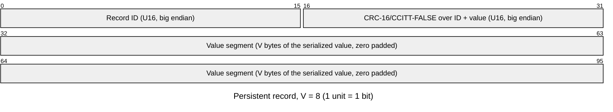
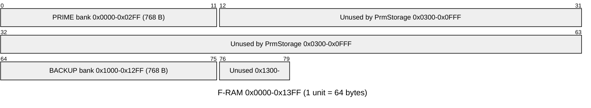
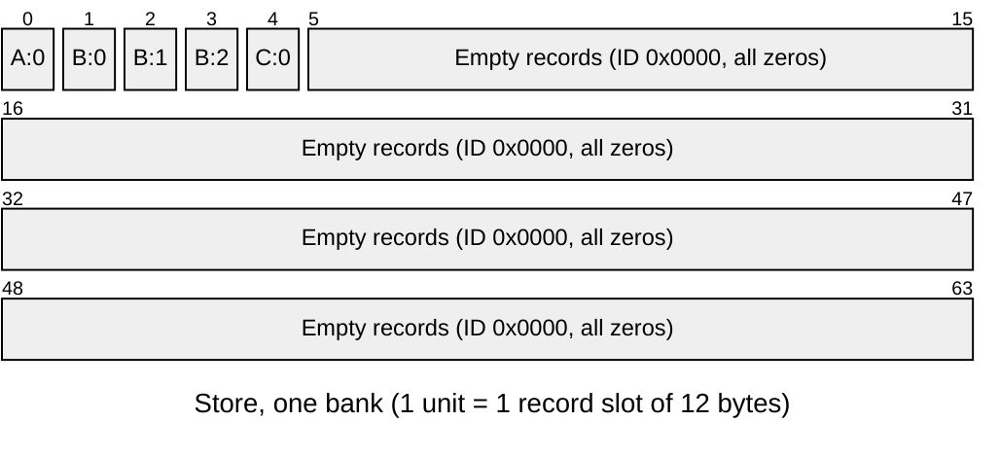
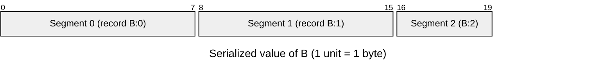
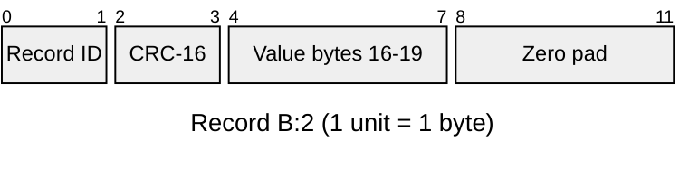
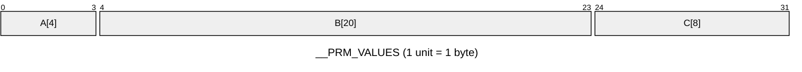
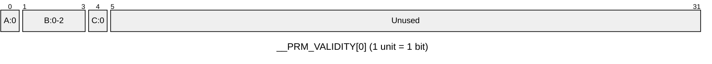
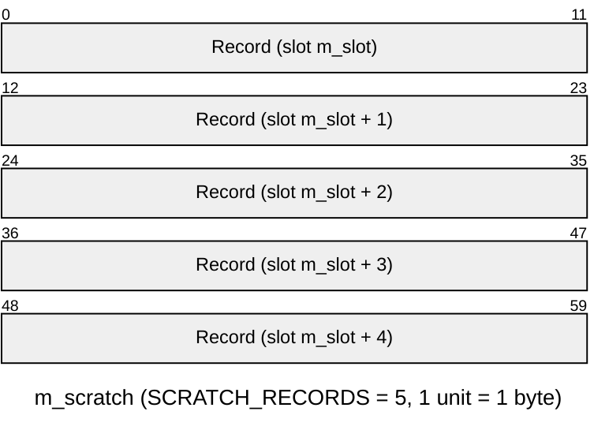

# Samd21::StaticPrmDb

A small bare-metal implementation of PrmDb

## Introduction

`StaticPrmDb` holds every parameter of a deployment in statically allocated memory and saves them to,
or loads them from, a persistent store made of self-identifying fixed-size records. The layout is
generated at build time by `tools/static-prm-db` from the deployment dictionary.

The persistent format is independent of the in-memory layout. One bad record makes only its own
parameter invalid. Records from an older dictionary still load. Two partially valid stores (e.g. the
`PrmStorage` PRIME and BACKUP banks) can be overlaid.

## Requirements

| Name | Description | Rationale | Validation |
|---|---|---|---|
| PRM-DB-001 | The database shall serve every parameter of the deployment, reporting each one either valid with its value or invalid. A parameter is valid only when every byte of its value came from a single `setPrm` or from records that passed their integrity check. | Components must never run on a partial or corrupted value; an invalid parameter falls back to its default. | Unit Test |
| PRM-DB-002 | A save followed by a load shall restore every parameter that was valid at the save, and only those. | A parameter with no valid value must not be persisted as though it had one. | Unit Test |
| PRM-DB-003 | Corruption of any part of the persistent store shall invalidate only the parameters whose stored bytes it touches; every other parameter shall still load. | A single bit flip (radiation, F-RAM wear) must not take out the whole database, as a whole-image checksum or header would. | Unit Test |
| PRM-DB-004 | A store saved by an earlier dictionary shall load every parameter whose name and serialized type are unchanged. A parameter that was removed, renamed or retyped shall be skipped and reported, never decoded as another parameter. | Software updates add, remove and renumber parameters; flight values must survive the update without a re-upload, and a changed type must not be misread. | Unit Test |
| PRM-DB-005 | The database shall overlay two partially valid stores so that a value valid in the first store loaded keeps precedence, and the second fills in only parameters the first left invalid. | Redundant banks (`PrmStorage` PRIME / BACKUP): the newest good value wins, and a parameter survives as long as either bank holds a good copy. | Unit Test |
| PRM-DB-006 | Load shall not fail because of the store's contents; it shall fail only when storage reports an error, and shall report how many records were valid, corrupt or unknown and how many parameters are left invalid. | Boot must always come up with as many parameters as possible; the operator decides from telemetry whether to re-load or re-save. | Unit Test |
| PRM-DB-007 | A failed storage transfer shall fail the command in progress without invalidating any parameter value in memory. Parameters read before a failed load shall still be delivered to their components. | A storage fault must not leave the software with fewer parameters than it had, and the redundant store can still fill in the rest. | Unit Test |
| PRM-DB-008 | While a save or load is in progress, parameter updates shall be rejected and reported, and concurrent save or load commands shall be rejected busy. | The values being saved or loaded must not change mid-transfer. | Unit Test |
| PRM-DB-009 | Save and load shall complete in bounded stack whether storage completes each transfer asynchronously or inside the call that started it. | Storage drivers differ in completion model; recursion depth growing with the store size would overflow a 16 KB part's stack. | Unit Test |
| PRM-DB-010 | The persistent store shall have a fixed, configured size that does not change with the dictionary, and the build shall fail if the deployment's parameters do not fit it. | A store whose size moved with the dictionary would invalidate the storage layout (banks) on every update; overflow must be caught before flight. | Inspection (static_assert) |
| PRM-DB-011 | Each persistent record shall identify the parameter it holds by an ID that is the same in every build of the same dictionary, and the build shall fail, naming the parameters involved and a model change that resolves it, when two records would share an ID or one would use a reserved ID. | Record IDs are part of the flight data format; a silent collision would load one parameter's value into another. | Inspection (generator diagnostics) |
| PRM-DB-012 | Parameter lookup and storage shall use no runtime tables or search: the deployment-specific layout shall be generated as code at build time. | Flash and RAM budget of a 16 KB / 128 KB part; generated code is optimized through by LTO. | Inspection (generated `<Top>StaticPrmDbAc.cpp`) |
| PRM-DB-013 | The trade-off between per-record overhead and padding shall be a project configuration (record value size), with every derived size, including the largest storable parameter, following from it. The build shall fail, naming the parameter, if one does not fit. | The best record size depends on the deployment's parameter sizes and the storage budget; a parameter too large for the layout must be caught before flight. | Inspection (generator diagnostics) |

## Design

### Persistent record



`V` is `StaticPrmDbConfig.RECORD_VALUE_SIZE` (default 8, so a 12-byte record). A parameter of `N`
bytes takes `ceil(N / V)` records. The CRC covers the ID, so a bit flip in the
ID cannot move a value onto another parameter. IDs `0x0000` (empty slot, written as all zeros) and
`0xFFFF` (erased storage) are reserved. Slots holding them are skipped without a CRC check.

The record ID is the CRC-16 of `<instance>.<param>:<type encoding>:<segment>/<V>`. It depends only on
what the record holds, not on parameter IDs or dictionary order:

- Renumbering instance base IDs, or adding or removing other parameters, keeps every stored value.
- Renaming a parameter or changing how its bytes are read (type, enum constants, struct members,
  array sizes) gives it a new ID. The old records are then skipped as *unknown*, not misread.
- Changing `V` gives every record a new ID, so a store saved with another record size loads as
  all *unknown* (and, with a different record size, mostly *corrupt*). Re-save after changing it.
- The generator fails the build when two record IDs collide or one hits a reserved ID (see
  below).

#### Persistent layout

The store is `STORE_RECORDS` back-to-back records, `STORE_SIZE = STORE_RECORDS * (V + 4)` bytes,
with no header or trailer. `PrmStorage` places one store in each of its banks. With the default
configuration (`V` = 8, `STORE_RECORDS` = 64, `PRIME_OFFSET` = `0x0000`, `BACKUP_OFFSET` =
`0x1000`), each bank is 768 bytes:



The rest of the F-RAM (up to `Fram.FramConfig.Size` = `0x40000`) is not used by `PrmStorage`.

A `SAVE` packs the records of valid parameters from slot 0, in parameter order, and writes the
remaining slots as empty records. For the three parameters of the [in-memory example](#in-memory-layout)
(`A` 1 record, `B` 3 records, `C` 1 record):



Records identify themselves, so the loader does not rely on their position. If `B` were invalid
at the save, its records would be skipped and `C:0` would go in slot 1. Each transfer moves
`SCRATCH_RECORDS` slots (5 x 12 = 60 B, within `Fram.FramConfig.MaxTransfer` = 64), so the store
takes 13 transfers, the last one 4 records long.

A parameter of `N` bytes is split across `ceil(N / V)` records, segment `s` holding value bytes
`[s * V, min((s + 1) * V, N))`. For `B` (`N` = 20):





#### Resolving record ID conflicts

With 16-bit IDs a deployment of `n` records has about `n²/131072` colliding pairs (0.03 at 64
records, 0.12 at 128), so an occasional build will hit one. It is resolved with a seed on the
component instance, which appends `#<seed>` to the key of every record of that parameter:

```fpp
@! prm-id-seed COUNTING=1 CHILLIN=3
instance fwHealth: Svc.Health base id 0xAA50
```

The seed is in the model, so the IDs are the same in every build. It goes on the instance rather
than the parameter: a collision depends on the deployment's whole parameter set, and the parameter
is often defined in a component the deployment cannot edit. A parameter with no seed keeps the
unseeded key.

The generator reports every conflict of the deployment at once, each pointing at the parameter(s)
involved and noting, on the instance definition, the exact `@!` line that frees it:

```
error: record ID 0x7313 of `Top.a.Y:U32:0/8` collides with `Top.a.X:U32:0/8`
   = note: changing a parameter's seed changes its record IDs, so its stored value loads as
           unknown until the next SAVE: seed the parameter added most recently
   ----- either: move `Top.a.Y` to record ID 0x0a9f by annotating its instance:
             @! prm-id-seed Y=1
   ----- or: move `Top.a.X` to record ID 0x03f4 by annotating its instance:
             @! prm-id-seed X=1
```

The suggested seeds avoid every ID in use and every other suggestion in the report, so the
suggestions can be applied together. Seed the newer parameter: changing a seed moves that
parameter's records, and its stored value loads as *unknown* until the next `SAVE`. A malformed
annotation, a repeated parameter or a parameter the instance does not have fails the build.

### In-memory store

Generated per deployment (`<Topology>StaticPrmDbAc.cpp`). There are no lookup tables: the generator
resolves every mapping at build time and emits it as code.

- `__PRM_VALUES`: a struct with one byte-array member per parameter.
- `__PRM_VALIDITY`: one bit per record. A parameter's records share one 32-bit word, so checking
  a parameter is a single `(word & mask) == mask`.
- `readParam` / `writeParam`: a `switch` on the parameter ID.
- `loadRecord`: a `switch` on the stored record ID.
- `saveRecord`: a `switch` on the record index, in parameter order.

The scratch buffer (`SCRATCH_RECORDS * PrmRecord::SIZE` bytes) is a member of the component. All
size checks that depend only on configuration live in `StaticPrmDb.hpp`; the generated file only
checks what depends on the dictionary (every record fits in `STORE_RECORDS`, and it was generated
for the configured `RECORD_VALUE_SIZE`).

Each case only passes constants (member address, size, validity word and mask, record ID) to a
shared static helper. LTO folds the helpers, so the code size per parameter is a few argument loads
and a branch.

The component itself holds no deployment knowledge. It runs the transfer state machine and the
record CRC/packing, and calls the generated functions above.

#### In-memory layout

All of it is static: the two generated globals and the component instance. Parameters appear in
parameter ID order. The example below has three parameters, `A` (`U32`, 1 record), `B` (20 B,
3 records) and `C` (`F64`, 1 record).

`__PRM_VALUES` holds each parameter's serialized bytes. Its members are all `U8` arrays, so there
is no padding between them:



`__PRM_VALIDITY` has one bit per record, assigned in the same order. When a parameter's records
would not fit in the bits the current word has left, it starts the next word. Bits left over at
the end of a word stay unused. Bit 0 is the least significant bit:



`B` is valid when `(__PRM_VALIDITY[0] & 0x0000000E) == 0x0000000E`.

The component's scratch buffer holds the records of the transfer in flight in store format, so a
transfer of slots `m_slot .. m_slot + 4` maps byte for byte onto the store:



`readParam` reports a parameter valid only when every one of its bits is set. `writeParam` (from
`setPrm`) sets them all. `loadRecord` sets one bit per record, so a parameter whose segments came
from different records of the same store is valid only when all of them loaded. The RAM used
depends on the dictionary: `sum(N_i)` bytes of values plus 4 bytes per validity word. The
component instance itself has a fixed size.

### Save

The store is `StaticPrmDbConfig::STORE_RECORDS` slots and is always written in full, one
scratch-sized transfer at a time (`writeOut(offset, buffer)`). `saveRecord` packs each record of a
valid parameter, in order. Invalid parameters are skipped and counted. The remaining slots are filled
with empty records, so records from an earlier save cannot come back.

### Load

`REPLACE` clears every validity bit first. `MERGE` keeps them. The store is read one scratch-sized
transfer at a time (`readOut(offset, buffer)`). For each record:

1. Empty or blank slots are skipped.
2. A CRC mismatch counts as *corrupt*.
3. An ID `loadRecord` does not know counts as *unknown*.
4. Otherwise the record is *valid*. `loadRecord` copies its segment into memory and sets its
   validity bit, unless the load is a `MERGE` and the bit is already set.

After the last transfer (or a failed read), the component reports `LoadedDatabase` and the
`ValidRecords`, `CorruptRecords` and `InvalidParameters` telemetry. It then goes idle and calls the
deployment's `loadParameters()`, so every component reads its parameters back through `getPrm`.
`LOAD` fails only when storage reports an error. Corrupt and unknown records only show up in the
counts.

### Transfers

There is one transfer in flight at a time. If storage completes a transfer inside the call that
started it, the completion handler only records that. `transferLoop` then issues the next transfer,
so the stack depth stays the same however many transfers the store takes.

### Ports

| Port | Kind | Meaning |
|---|---|---|
| `getPrm` / `setPrm` | guarded in / sync in | Framework parameter interface |
| `writeOut` / `writeReturnIn` | out / sync in | `Samd21.PrmTransfer(offset, buffer)` of whole records; completion with the same buffer |
| `readOut` / `readReturnIn` | out / sync in | Same, for reads |

### Commands, telemetry, events

| Item | Kind | Meaning |
|---|---|---|
| `SAVE` | command | Write every valid parameter to the store |
| `LOAD(mode)` | command | `REPLACE`: load the store into an empty database. `MERGE`: fill in from a redundant store |
| `ValidRecords` / `CorruptRecords` / `InvalidParameters` | telemetry | Result of the last load |
| `LoadedDatabase` | activity high | Load finished: valid / corrupt / unknown records, invalid parameters |
| `SavedDatabase` | activity high | Save finished: parameters written / skipped as invalid |
| `ReadFailed` | warning high | Storage failed a read; `LOAD` fails with what was read so far |
| `DroppingPrmSave` | warning high | `setPrm` during a transfer was dropped |

## Configuration

The record value size is an FPP constant, because the autocoder needs it as well as the C++. It
lives in `samd-config/Samd21StaticPrmDbConfig.fpp` (override via `CONFIGURATION_OVERRIDES`):

| Constant | Meaning |
|---|---|
| `Samd21.StaticPrmDbConfig.RECORD_VALUE_SIZE` | Value bytes per record (`PrmRecord::VALUE_SIZE`). The record is this plus 4 bytes. |

`PrmRecord::SIZE`, `VALUE_OFFSET` and the other record offsets are derived from it. A small value
wastes less padding on small parameters; a large one spends less per-record overhead on large
ones. With parameter sizes `N_i`, the store needs `sum(ceil(N_i / V)) * (V + 4)` bytes, so choose
`V` to minimize that.

A parameter may take at most 32 records, since its validity bits share one `U32` word (one mask
test per lookup), so the largest stored parameter is `32 * V` bytes (256 with the default). The
generator fails the build on a larger one and names the smallest `V` that fits it.

The rest is compile-time, in `samd-config/StaticPrmDbConfig.hpp` (override via
`CONFIGURATION_OVERRIDES`). Everything is in records, so it scales with the record size:

| Constant | Meaning |
|---|---|
| `SCRATCH_RECORDS` | Records per transfer. The scratch buffer is `SCRATCH_RECORDS * PrmRecord::SIZE` bytes. Keep it at or below the storage's natural request size (e.g. 5 x 12 = 60 for Fram `MaxTransfer` 64) |
| `STORE_RECORDS` | Record slots in the store. Fixed so the store does not move with the dictionary. Must hold every record of the deployment (build fails otherwise). `PrmStorage` checks the store fits its banks |
