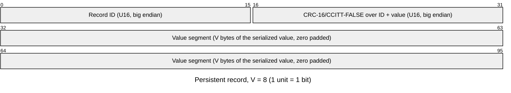
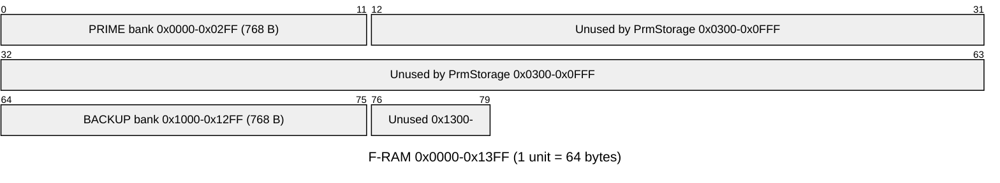
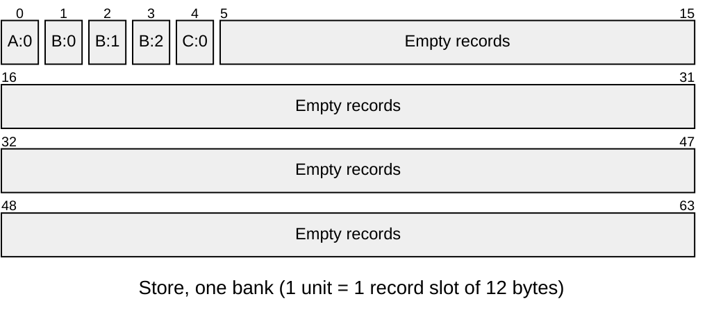
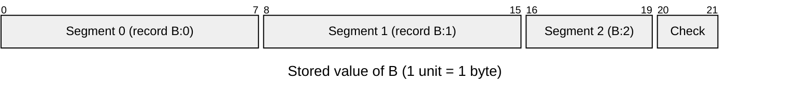
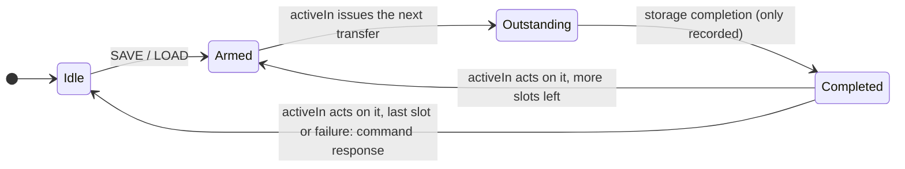

# Samd21::StaticPrmDb

A small bare-metal implementation of PrmDb

## Introduction

`StaticPrmDb` holds every parameter of a deployment in statically allocated memory and saves them to,
or loads them from, a persistent store made of self-identifying fixed-size records. The layout is
generated at build time by `tools/static-prm-db` from the deployment dictionary.

The persistent format is independent of the in-memory layout. One bad record makes only its own
parameter invalid. A parameter split over several records loads only when all of them are of the
same save, so an interrupted save cannot produce a mixed value. Records from an older dictionary
still load. Two partially valid stores (e.g. the `PrmStorage` PRIME and BACKUP banks) can be
overlaid.

## Requirements

| Name | Description | Rationale | Validation |
|---|---|---|---|
| PRM-DB-001 | The database shall serve every parameter of the deployment, reporting each one either valid with its value or invalid. A parameter is valid only when every byte of its value came from a single `setPrm`, or from records that passed their integrity check and hold one stored value. | Components must never run on a partial or corrupted value; an invalid parameter falls back to its default. | Unit Test |
| PRM-DB-002 | A save followed by a load shall restore every parameter that was valid at the save, and only those. | A parameter with no valid value must not be persisted as though it had one. | Unit Test |
| PRM-DB-003 | Corruption of any part of the persistent store shall invalidate only the parameters whose stored bytes it touches; every other parameter shall still load. | A single bit flip (radiation, F-RAM wear) must not take out the whole database, as a whole-image checksum or header would. | Unit Test |
| PRM-DB-004 | A store saved by an earlier dictionary shall load every parameter whose name and serialized type are unchanged. A parameter that was removed, renamed or retyped shall be skipped and reported, never decoded as another parameter. | Software updates add, remove and renumber parameters; flight values must survive the update without a re-upload, and a changed type must not be misread. | Unit Test |
| PRM-DB-005 | The database shall overlay two partially valid stores so that a value valid in the first store loaded keeps precedence, and the second fills in only parameters the first left invalid, each one whole from that store. | Redundant banks (`PrmStorage` PRIME / BACKUP): the newest good value wins, and a parameter survives as long as either bank holds a good copy. The banks may hold different saves, so a value pieced together from both could match neither. | Unit Test |
| PRM-DB-006 | Load shall not fail because of the store's contents; it shall fail only when storage reports an error, and shall report how many records were valid, corrupt or unknown, how many parameters were rejected as mixed from different saves, and how many are left invalid. | Boot must always come up with as many parameters as possible; the operator decides from telemetry whether to re-load or re-save. | Unit Test |
| PRM-DB-007 | A failed storage transfer, or a save or load commanded with no storage connected, shall fail the command in progress. A failed save shall leave every parameter value in memory unchanged. A failed load shall keep each parameter it had not loaded any record of with the value and validity it had before the load, shall invalidate a parameter it had loaded only some records of, and shall deliver every parameter to its component. | A storage fault must not leave the software with fewer parameters than it had, and the redundant store can still fill in the rest. A parameter cut by the failure has been partly overwritten in memory and can be neither its old nor its new value; holding it valid would need a second copy of every value in RAM. | Unit Test |
| PRM-DB-008 | While a save or load is in progress, parameter updates shall be rejected and reported, and concurrent save or load commands shall be rejected busy. | The values being saved or loaded must not change mid-transfer. | Unit Test |
| PRM-DB-009 | Save and load transfers shall be issued only from the main-context scheduler (`activeIn`), at most one per call, and never from a storage completion, whether storage completes a transfer asynchronously or inside the call that started it. | Starting the next transfer from a completion nests it inside the storage stack that completed the last one, and makes the call graph recursive (JPL C Rule 4); one transfer per call keeps stack depth and the time spent per call bounded. | Unit Test |
| PRM-DB-015 | A successful save shall emit no event. A failed save shall be reported by a throttled event, re-armed by the next successful save. | Saves may be commanded every second; an event per save would flood the event log, and a persistent storage failure must not either. | Unit Test |
| PRM-DB-010 | The persistent store shall have a fixed, configured size that does not change with the dictionary, and the build shall fail if the deployment's parameters do not fit it. | A store whose size moved with the dictionary would invalidate the storage layout (banks) on every update; overflow must be caught before flight. | Inspection (static_assert) |
| PRM-DB-011 | Each persistent record shall identify the parameter it holds by an ID that is the same in every build of the same dictionary, and the build shall fail, naming the parameters involved and a model change that resolves it, when two records would share an ID or one would use a reserved ID. | Record IDs are part of the flight data format; a silent collision would load one parameter's value into another. | Inspection (generator diagnostics) |
| PRM-DB-012 | Parameter lookup and storage shall use no runtime tables or search: the deployment-specific layout shall be generated as code at build time. | Flash and RAM budget of a 16 KB / 128 KB part; generated code is optimized through by LTO. | Inspection (generated `<Top>StaticPrmDbAc.cpp`) |
| PRM-DB-013 | The trade-off between per-record overhead and padding shall be a project configuration (record value size), with every derived size, including the largest storable parameter, following from it. The build shall fail, naming the parameter, if one does not fit. | The best record size depends on the deployment's parameter sizes and the storage budget; a parameter too large for the layout must be caught before flight. | Inspection (generator diagnostics) |
| PRM-DB-014 | A save interrupted at any point (power loss, storage failure) shall leave every parameter loading either whole from the interrupted save, whole from the save before it, or invalid. When a parameter's store holds more than one copy of a record, the copy the latest save wrote shall be loaded. | Each record passing its CRC only shows that record is intact: an interrupted save leaves good records of two saves side by side, and a value assembled from both would be accepted as valid. | Unit Test |

## Design

The component is split in two:

- **Generated, per deployment** (by `tools/static-prm-db`): parameter storage and every mapping
  between a parameter, its records and its memory, emitted as code with no runtime tables.
- **Generic**: the save/load sequencing, record packing and integrity checks, commands, telemetry
  and events. It holds no knowledge of the deployment's parameters.

### Persistent record

The store is made of fixed-size records. Each holds one segment of one parameter's value:



`V` is the configured record value size (default 8, so a 12-byte record). A parameter that fits in
`V` bytes takes one record. A larger one is split over several records, together with a 2-byte
[value check](#value-check).

The CRC covers the ID, so a bit flip in the ID cannot move a value onto another parameter. IDs
`0x0000` (empty slot) and `0xFFFF` (erased storage) are reserved and are skipped without a CRC
check.

#### Record ID

A record's ID is a CRC-16 of what the record holds: the parameter's instance and name, its
serialized type, the segment number and `V`. It does not depend on parameter IDs or dictionary
order, so:

- Renumbering base IDs, or adding or removing other parameters, keeps every stored value.
- Renaming a parameter or changing how its bytes are read (type, enum constants, struct members,
  array sizes) changes its IDs. Its old records are skipped as *unknown*, not misread.
- Changing `V` changes every ID. Re-save after changing it.

The generator fails the build when two IDs collide or one hits a reserved ID
(see [Resolving record ID conflicts](#resolving-record-id-conflicts)).

#### Value check

A record's CRC shows that record is intact. It does not show that all of a parameter's records
come from the same save. Two cases mix saves:

- **Interrupted save.** A save writes the store front to back. If it is cut short, the front of
  the store holds the new save and the rest holds the old one. A parameter whose records straddle
  that point has intact records from both saves.
- **Merge.** If one of a parameter's records is corrupt in PRIME, the matching record in BACKUP
  (possibly from a different save) could complete it.

A parameter that takes more than one record therefore stores a CRC-16 of its whole value after the
value itself, and it is split across the records along with the value. A load accepts the
parameter only if the reassembled value matches its check. Single-record parameters need no value
check, since the record CRC already covers the whole value.

The check is stored in the target's native byte order. A store is only loaded by the target that
saved it; read with the other byte order, every value check fails and those parameters come back
invalid rather than wrong.

A per-record save counter was considered and rejected: it needs state that survives a reboot, can
wrap, costs bits in every record, and would stop a merge from combining banks that hold the same
value. The value check is derived from the value itself, so records combine exactly when they make
up a consistent value (a false match has probability 2⁻¹⁶).

An interrupted save cannot be recovered, since the new value was never fully written. With the
value check, the parameter loads as its previous value, as its value from the other bank, or as
invalid, never as a mix.

#### Persistent layout

The store is a fixed number of back-to-back records (`STORE_RECORDS`), with no header or trailer.
`PrmStorage` places one store in each of its two banks. With the default configuration (`V` = 8,
64 records), each bank is 768 bytes:



A save writes the records of every valid parameter from the start of the store, in parameter
order, and fills the remaining slots with empty records. For three parameters `A` (`U32`),
`B` (20 bytes) and `C` (`F64`):



Records identify themselves, so the loader does not rely on their position: had `B` been invalid
at the save, `C:0` would be in slot 1.

`B` takes three records because its 20 value bytes and 2 check bytes are split 8 + 8 + 6:



#### Resolving record ID conflicts

With 16-bit IDs, a deployment of `n` records has about `n²/131072` colliding pairs (0.03 at 64
records, 0.12 at 128), so an occasional build will hit one. A collision is resolved by giving the
parameter a seed on its component instance, which changes all of that parameter's record IDs:

```fpp
@! prm-id-seed COUNTING=1 CHILLIN=3
instance fwHealth: Svc.Health base id 0xAA50
```

The seed is part of the model, so IDs are the same in every build. It goes on the instance rather
than the parameter because a collision depends on the deployment's whole parameter set, and the
parameter is often defined in a component the deployment cannot edit.

The generator reports every conflict at once, with a ready-to-paste annotation for each:

```
error: record ID 0x7313 of `Top.a.Y:U32:0/8` collides with `Top.a.X:U32:0/8`
   = note: changing a parameter's seed changes its record IDs, so its stored value loads as
           unknown until the next SAVE: seed the parameter added most recently
   ----- either: move `Top.a.Y` to record ID 0x0a9f by annotating its instance:
             @! prm-id-seed Y=1
   ----- or: move `Top.a.X` to record ID 0x03f4 by annotating its instance:
             @! prm-id-seed X=1
```

The suggestions avoid each other and every ID in use, so they can all be applied together. Seed the
newer parameter, since a seeded parameter's stored value loads as *unknown* until the next `SAVE`.
A malformed annotation, or one naming a repeated or non-existent parameter, fails the build.

### In-memory store

All memory is static and sized by the generator from the dictionary:

- **Values**: the serialized bytes of every parameter.
- **Value checks**: one 16-bit check per multi-record parameter.
- **Validity**: one bit per record. A parameter is valid only when all of its record bits are set,
  and its bits never span a word boundary, so this is a single mask test.
- **Load tracking**: one bit per record, marking which records the load in progress has copied
  into memory.

RAM use is the total size of all parameter values, plus 2 bytes per multi-record parameter, plus
8 bytes per 32 records (validity and load tracking). The component itself has a fixed size,
including a buffer for one storage transfer.

`setPrm` sets all of a parameter's validity bits and computes its value check. Validity changes
otherwise only at the end of a load, so between loads every parameter is either wholly valid or
wholly invalid.

### Save

A save writes the whole store, one transfer at a time: the records of every valid parameter, then
empty records for the rest of the store. Filling the rest makes sure records from an earlier save
cannot come back. Invalid parameters are skipped.

A successful save emits no event, since saves may be commanded every second. A failed one emits
`WriteFailed`, throttled; the next successful save re-arms it.

### Load

A load reads the whole store, one transfer at a time, and checks each record:

1. Empty or erased slots are skipped.
2. A CRC mismatch counts as *corrupt*.
3. An ID that is not in the dictionary counts as *unknown*.
4. Otherwise the record is *valid* and its segment is copied into memory. A segment already copied
   by this load is not overwritten, and in `MERGE` mode neither is a parameter that was already
   valid.

The first copy of a record wins. Since a save writes front to back, when an interrupted save leaves
two copies of a record, the earlier one is the newer.

Validity does not change until the load ends, either after the last transfer or on a failed read.
Then each parameter's validity is set from the records this load copied:

| Records of the parameter loaded | Validity after the load |
|---|---|
| None, `REPLACE` read the whole store | Invalid: the store does not hold it |
| None, otherwise (`MERGE`, or a failed read) | Unchanged: its value in memory was not touched |
| Some, not all (corrupt, unknown, or not read before a failure) | Invalid: its value is partly overwritten |
| All, value check fails (records of different saves) | Invalid, counted *incoherent* |
| All, value check passes (or single record) | Valid |

So a failed `REPLACE` keeps every parameter it did not reach as it was, and a following `MERGE` of
the other bank fills in whatever is left invalid, each parameter from that bank alone.

The component then reports the result (`LoadedDatabase` event and load telemetry) and has the
deployment's components read their parameters back. `LOAD` fails only when storage reports an
error. Corrupt and unknown records and incoherent parameters only show up in the counts. A non-zero
incoherent count means a save was interrupted; a fresh `SAVE` to that bank clears it.

### Transfers

`SAVE` and `LOAD` only arm the transfer; the transfers are run by `activeIn`, called from the
main context by the deployment's `PassiveCycler` like the other SAMD components:



Each `activeIn` call acts on the completed transfer, if any, then issues at most one transfer, and
returns whether it did work, so the cycler calls it again before the processor sleeps. A storage
completion only records its status, whether it arrives asynchronously or inside the call that
issued the transfer. No transfer is therefore ever started from inside the storage stack, the
call graph has no cycle, and a command sent from the response of the last one starts cleanly on
the next call.

A save or load commanded on a deployment that connects no storage fails with `NoStorage`. Detecting
a transfer that never completes is the storage's job (F-RAM / SPI transaction timeouts): until it
completes, the database stays busy.

### Ports

| Port | Kind | Meaning |
|---|---|---|
| `getPrm` / `setPrm` | sync in | Framework parameter interface |
| `activeIn` | sync in | Main-context scheduler (`PassiveCycler.cycleOut`); runs the transfers |
| `writeOut` / `writeReturnIn` | out / sync in | Write whole records at a store offset; completion returns the same buffer |
| `readOut` / `readReturnIn` | out / sync in | Same, for reads |

### Commands, telemetry, events

| Item | Kind | Meaning |
|---|---|---|
| `SAVE` | command | Write every valid parameter to the store |
| `LOAD(mode)` | command | `REPLACE`: take every parameter from the store, invalid if it holds none. `MERGE`: fill in invalid parameters, whole, from a redundant store |
| `ValidRecords` / `CorruptRecords` / `IncoherentParameters` / `InvalidParameters` | telemetry | Result of the last load |
| `LoadedDatabase` | activity high | Load finished (`COMPLETE` or `READ_FAILED`): valid / corrupt / unknown records, incoherent / invalid parameters |
| `ReadFailed` | warning high | Storage failed a read; `LOAD` fails, keeping what was read so far and the parameters it did not reach |
| `WriteFailed` | warning high, throttled (5) | Storage failed a write; `SAVE` fails. Re-armed by the next successful save |
| `NoStorage` | warning high | `SAVE` or `LOAD` on a deployment with no storage connected; the command fails |
| `DroppingPrmSave` | warning high | `setPrm` during a save or load was dropped |

## Configuration

All configuration lives in `samd-config/` and can be overridden via `CONFIGURATION_OVERRIDES`.

| Constant | File | Meaning |
|---|---|---|
| `Samd21.StaticPrmDbConfig.RECORD_VALUE_SIZE` | `Samd21StaticPrmDbConfig.fpp` | Value bytes per record (`V`). A record is `V + 4` bytes. An FPP constant, since the generator needs it too |
| `SCRATCH_RECORDS` | `StaticPrmDbConfig.hpp` | Records per storage transfer. Keep it within the storage's maximum request size (e.g. 5 × 12 = 60 B for an F-RAM `MaxTransfer` of 64) |
| `STORE_RECORDS` | `StaticPrmDbConfig.hpp` | Record slots in the store. Fixed so the store does not move with the dictionary. The build fails if the deployment's records do not fit, and `PrmStorage` checks the store fits its banks |

**Choosing `V`.** A small `V` wastes less padding on small parameters; a large one spends less
per-record overhead on large ones. For parameter sizes `N_i`, with `S_i = N_i` when `N_i <= V` and
`N_i + 2` otherwise, the store needs `sum(ceil(S_i / V)) * (V + 4)` bytes, so choose `V` to minimize
that. A parameter that just fits one record also avoids the value check.

A parameter may take at most 32 records, so the largest storable parameter is `32 * V - 2` bytes
(254 with the default). The generator fails the build on a larger one and names the smallest `V`
that fits it.
